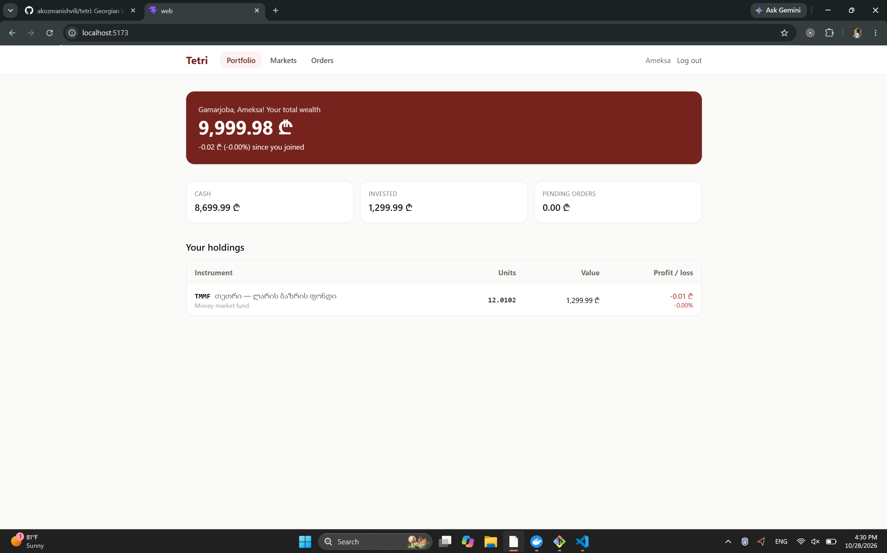
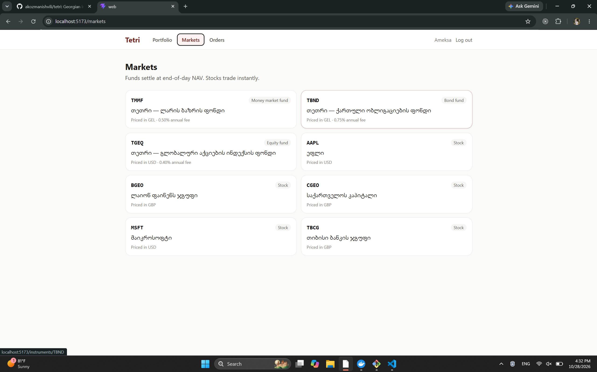
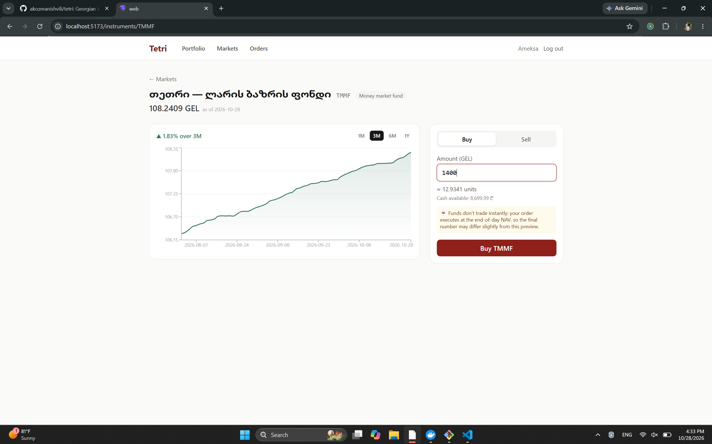
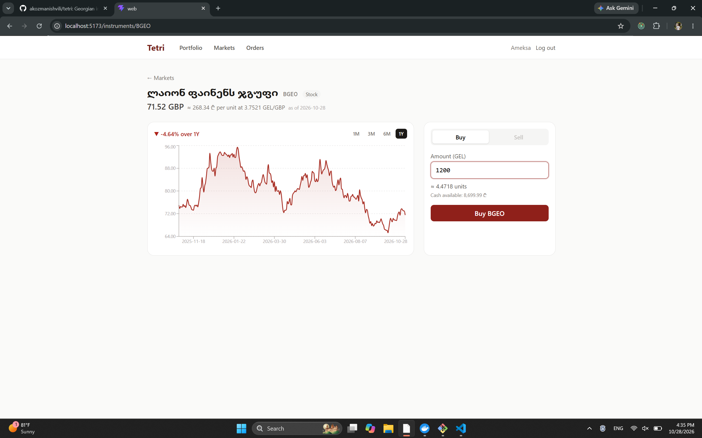
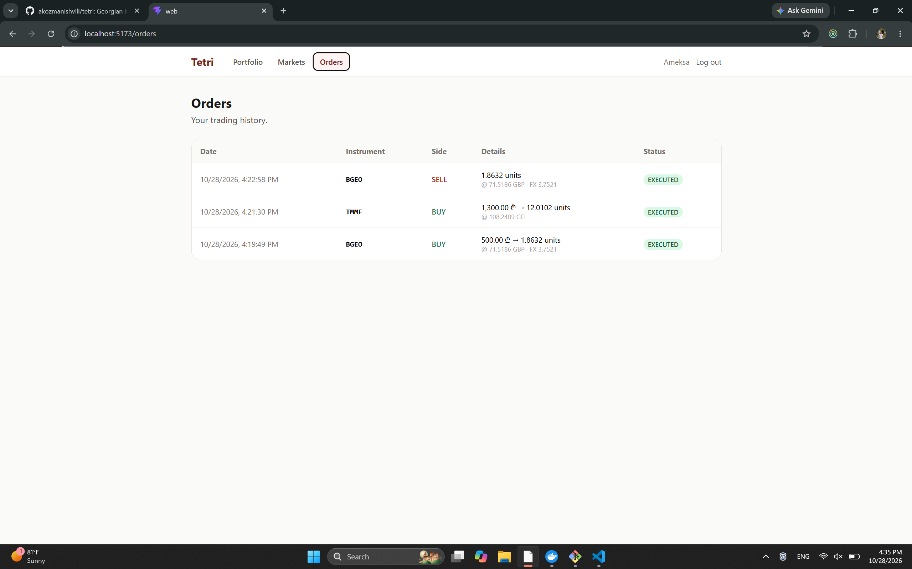
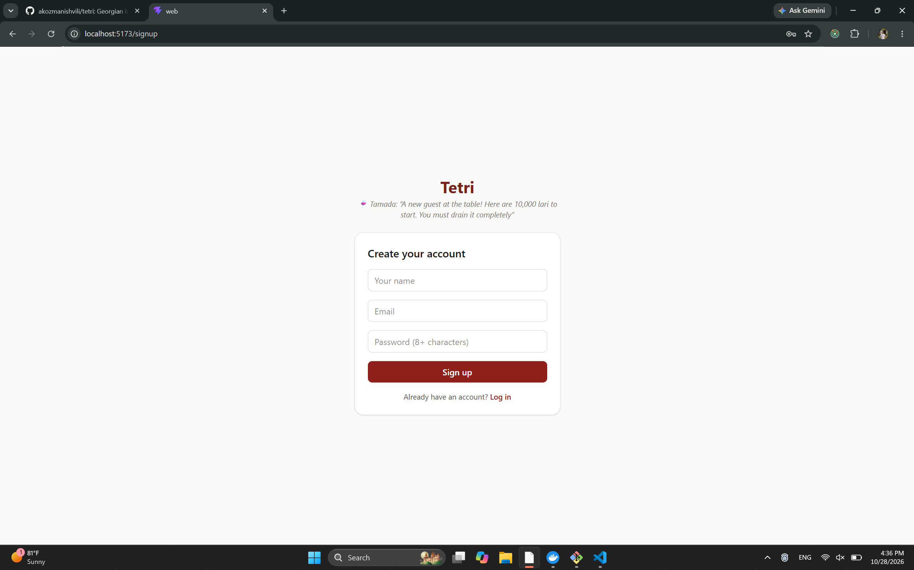
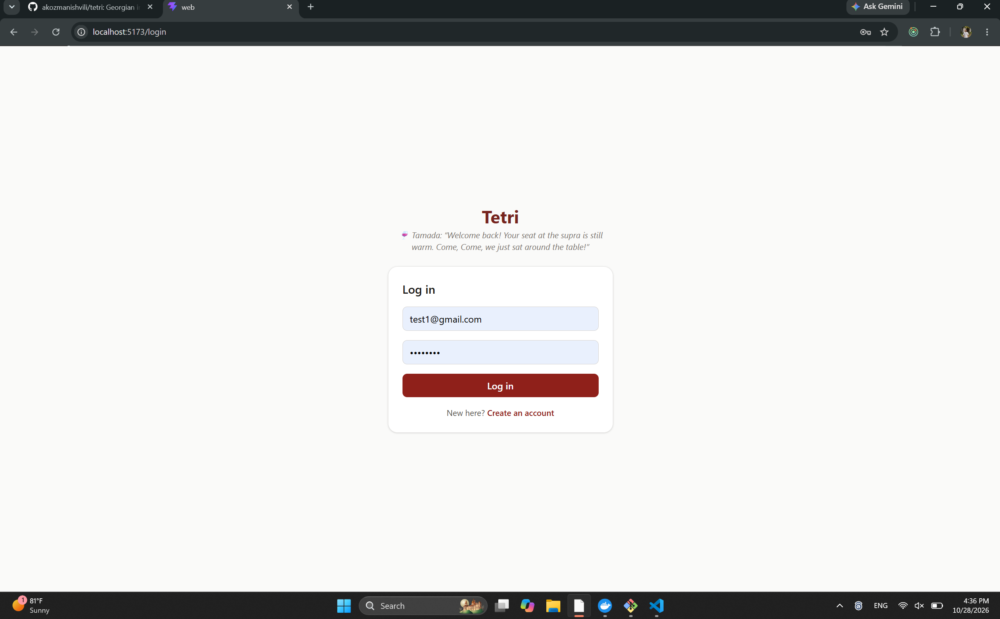
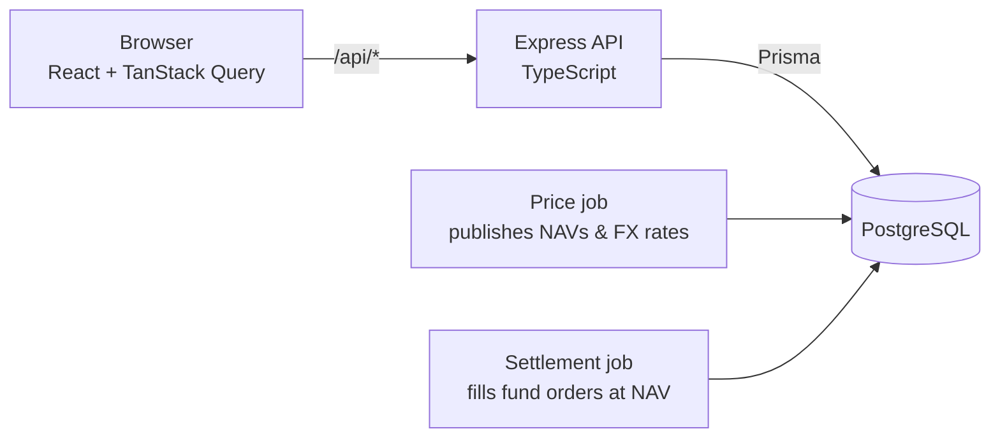

# Tetri 🇬🇪

**🌐 Live demo: https://d1mb2bkp03svje.cloudfront.net/**


**A Georgian investing simulator.** Practice investing with virtual lari across money market funds, bond funds, equity funds and stocks, including Georgian companies listed in London, without risking a single real tetri.

> ტეტრი — ისწავლე ინვესტირება ვირტუალური ლარით.



---

## Why Tetri?

Investment funds are brand new in Georgia: the country's first publicly offered fund only launched in 2024 and most people have never used one. Meanwhile, the tools that do exist are in English priced in dollars and assume you already know what a NAV is.

Tetri lets Georgians learn by doing, in lari, at zero risk:

- Every user starts with **10,000 virtual GEL**
- Buy and sell **funds and stocks**, including **Lion Finance Group (BGEO), TBC Bank Group (TBCG) and Georgia Capital (CGEO)**
- Foreign assets are converted to lari at the **official exchange rate**, so you see how currency moves affect your returns
- Funds behave like real funds: orders wait for the **end-of-day NAV** instead of executing instantly

## Screenshots

| Markets                                  | Instrument & trading                                 |
| ---------------------------------------- | ---------------------------------------------------- |
|  |  |

| Selling                                                    | Fund page                                                 |
| ---------------------------------------------------------- | --------------------------------------------------------- |
|  |  |

| Order history                          | Sign up                                 | Log in                                |
| -------------------------------------- | --------------------------------------- | ------------------------------------- |
|  |  |  |

## Features

- **Accounts:** sign up, log in and stay logged in across reloads with silent session restore
- **Portfolio:** total wealth, cash, invested and pending amounts, holdings with profit/loss
- **Markets:** money market, bond and equity funds plus stocks priced in GEL, USD and GBP
- **Trading:** buy by amount, sell by units, with a live "≈ you'll get" preview
- **Price charts:** 1M / 3M / 6M / 1Y price history for every instrument
- **Fund settlement:** pending fund orders execute at the trade date's NAV, and the order page updates by itself when they settle

## Tech stack

| Layer    | Technology                                                                                |
| -------- | ----------------------------------------------------------------------------------------- |
| Frontend | React, TypeScript, Vite, TanStack Query, React Router, Tailwind CSS, Recharts             |
| Backend  | Node.js, Express, TypeScript, Zod                                                         |
| Database | PostgreSQL 17, Prisma 7                                                                   |
| Auth     | argon2id password hashing, JWT access tokens, rotating refresh tokens in httpOnly cookies |
| Testing  | Vitest + Supertest, integration tests against a real PostgreSQL                           |
| DevOps   | Docker Compose, GitHub Actions CI, npm workspaces monorepo                                |

## Architecture



```
tetri/
├── apps/
│   ├── api/                 # Express + Prisma backend
│   │   ├── prisma/          # schema, migrations, seed
│   │   └── src/
│   │       ├── routes/      # auth, me, instruments, orders, portfolio
│   │       ├── services/    # trading engine, portfolio valuation
│   │       ├── jobs/        # price publishing, order settlement
│   │       └── middleware/  # auth guard, error handling
│   └── web/                 # React frontend
│       └── src/
│           ├── auth/        # session state, route guards
│           ├── pages/       # portfolio, markets, instrument, orders, auth
│           └── components/  # layout, price chart, trade form
├── docs/screenshots/
└── docker-compose.yml
```

## Engineering highlights

Money is unforgiving, so most of the interesting work in Tetri is about making sure value is never created or lost.

**Money is never a float.** Cash is stored as integer tetri (`BigInt`), and units, prices and FX rates use exact `Decimal` columns. Amounts travel through JSON as strings, and the frontend formats them with BigInt math.

**An append-only ledger is the source of truth.** Every movement of money (the starting grant, each buy, each sale) is a ledger row. The wallet balance is a cached sum, and the tests assert that the two always match.

**Trades are atomic and race-free.** Every trade runs in a database transaction that starts with `SELECT ... FOR UPDATE` on the user's wallet row. One user's trades run strictly one at a time, so "check balance, then deduct" can't be raced, and because every trade takes locks in the same order, deadlocks are impossible. A test fires five simultaneous orders at a balance that only covers three, and proves exactly three succeed.

**Rounding always favors the house.** Units bought and sale proceeds are both rounded down, so rounding can never be farmed to create money from nothing.

**Funds settle like real funds.** Fund orders reserve cash immediately, then wait for the NAV of their trade date. Settlement is idempotent: each order is re-checked inside the lock, so running the job twice can never fill an order twice.

**Secure, revocable sessions.** Short-lived JWT access tokens live only in memory. Refresh tokens live in httpOnly, SameSite=Strict cookies, are stored hashed, and rotate on every use. Reusing an old refresh token is treated as theft and revokes every session. Rotation uses a single conditional update, so two simultaneous refreshes can't both win.

**The frontend respects the backend's security model.** Token refresh is single-flight: parallel requests that hit an expired token share one refresh call instead of triggering reuse detection.

**Login doesn't leak which emails exist.** Wrong-password and unknown-email responses are identical, including in timing: a dummy argon2 verification runs when the user doesn't exist.

**Tests run against real PostgreSQL**, not mocks, because the bugs that matter here (transactions, unique constraints, row locks) only exist in a real database. CI runs typecheck, tests, lint and build on every pull request.

## Getting started

### Prerequisites

- Node.js 22.18+ or 24.11+
- Docker Desktop

### Setup

```bash
git clone https://github.com/akozmanishvili/tetri.git
cd tetri
npm install

# Environment
cp apps/api/.env.example apps/api/.env
# then set JWT_ACCESS_SECRET in apps/api/.env to a long random string:
node -e "console.log(require('crypto').randomBytes(48).toString('hex'))"

# Database
docker compose up -d
npm run db:migrate --workspace=api
npm run db:generate --workspace=api
npm run db:seed --workspace=api
npm run jobs:publish --workspace=api   # catch prices up to today

# Run frontend + backend together
npm run dev
```

Open http://localhost:5173 and create an account.

## API overview

| Method | Endpoint                          | Auth   | Description                                          |
| ------ | --------------------------------- | ------ | ---------------------------------------------------- |
| `POST` | `/api/auth/signup`                |        | Create an account with a 10,000 GEL starting balance |
| `POST` | `/api/auth/login`                 |        | Log in                                               |
| `POST` | `/api/auth/refresh`               | cookie | Rotate the refresh token, get a new access token     |
| `POST` | `/api/auth/logout`                | cookie | Revoke the current session                           |
| `GET`  | `/api/me`                         | ✓      | Current user and cash balance                        |
| `GET`  | `/api/instruments`                |        | All funds and stocks                                 |
| `GET`  | `/api/instruments/:symbol/prices` |        | Price history                                        |
| `GET`  | `/api/instruments/:symbol/quote`  |        | Latest price, FX rate and GEL price per unit         |
| `POST` | `/api/orders`                     | ✓      | Place a buy (by amount) or sell (by units) order     |
| `GET`  | `/api/orders`                     | ✓      | Order history                                        |
| `GET`  | `/api/portfolio`                  | ✓      | Cash, holdings, pending orders and total value       |

Example requests live in [`apps/api/requests.http`](apps/api/requests.http).

## Disclaimer

Tetri is an educational project. All money is virtual, fund data is simulated, and nothing here is investment advice.

## Author

Built by [Ameksa](https://github.com/akozmanishvili), a Computer Science & Economics student.
